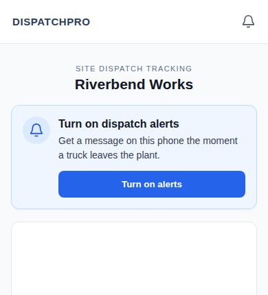
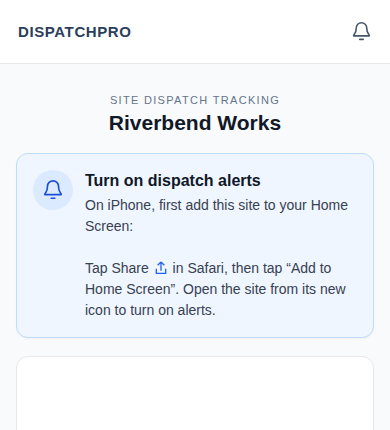
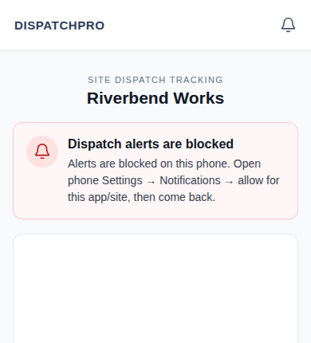
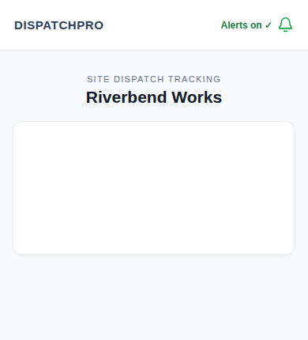

# DP-ALERTS-01 — Dispatch alert enrollment

## Delivered

- Site links show a full-width dispatch-alert card when the current phone is not subscribed.
- Plant and Admin pages show the same prompt in a smaller format.
- The existing bell control remains available. An active subscription shows “Alerts on ✓” next to the bell, and the prompt is hidden.
- iPhone Safari outside the installed Home Screen app shows Share / Add to Home Screen instructions before the subscribe action is available.
- A blocked notification permission keeps the card visible with the requested phone settings instructions.
- Each visit verifies the browser subscription uses the current VAPID public key and that the server still has a matching saved subscription for that role/site. A stale key or missing server record returns the user to the alert prompt.
- Added an endpoint to verify whether the current device's push subscription is still registered; it returns only a boolean status.

Existing notification content, SMS behavior, roles, PINs, site tokens, dispatch records, and challan numbering were not changed. No production data was changed and the app was not published.

## Phone-width state screenshots

These 390 px wide visual state previews show the four requested states. The live app preview could not show a valid site link, so these are not captures from an authenticated site session or a physical iPhone:

| State | Screenshot |
|---|---|
| Not subscribed |  |
| iPhone not installed |  |
| Notifications blocked |  |
| Alerts enabled |  |

## Verification

- `npm run test:alerts` — 7 state and key-validation tests pass.
- `npm run test:sitepulse` — existing integration tests pass.
- `npm run build` — succeeds.
- `npm run check` — still reports 41 existing TypeScript errors in unrelated areas: Admin party form, missing `@types/web-push`, and pre-existing Express 5 route parameter/nullability typing. No errors were reported in the alert state, notification toggle, or subscription status additions.
